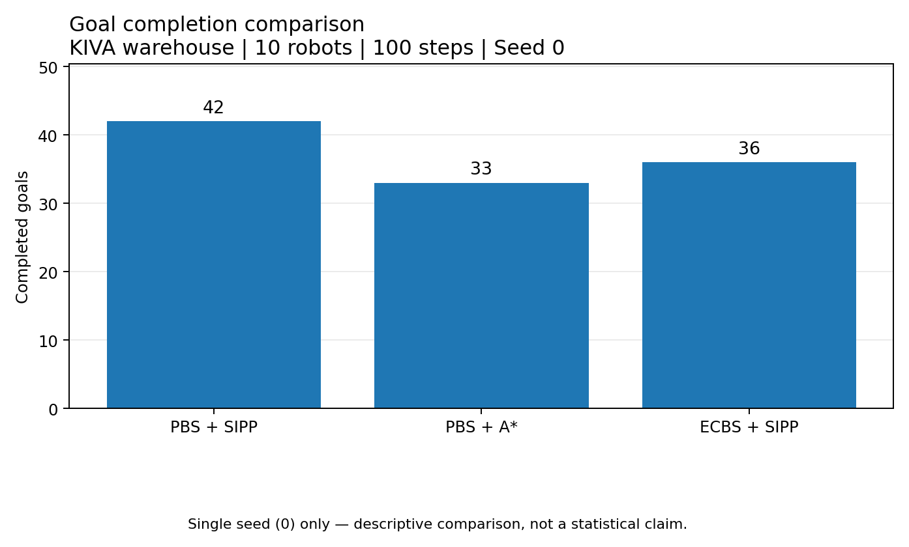
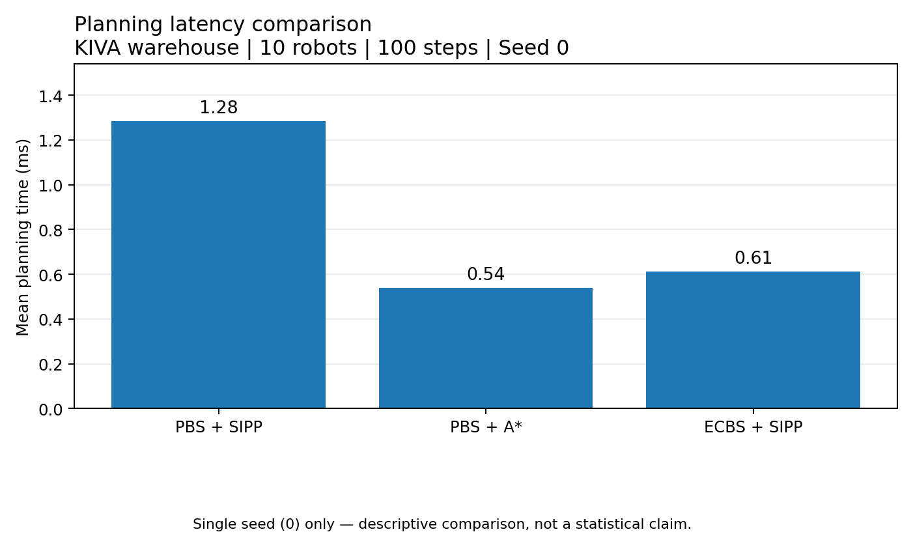
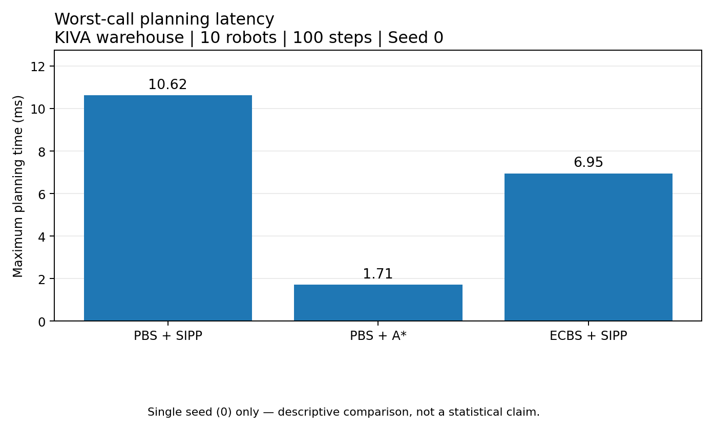
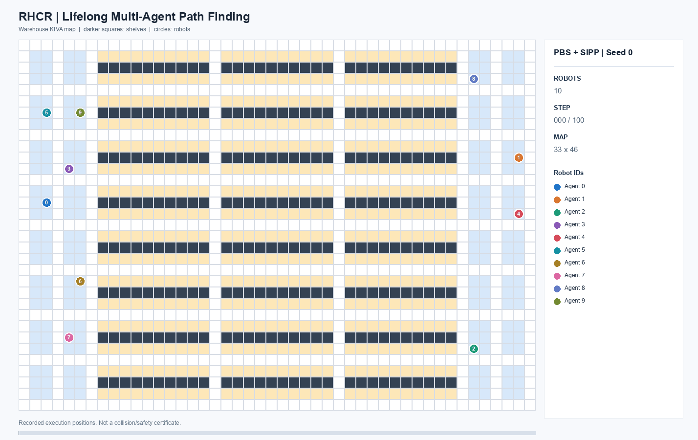
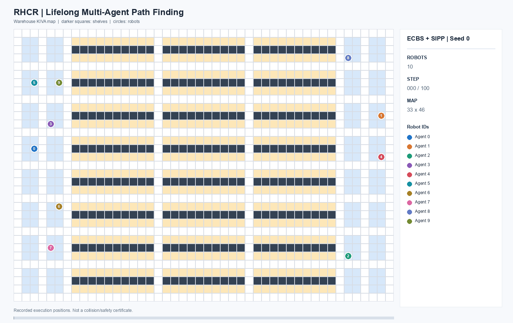

# RHCR Multi-Agent Pathfinding Benchmark

Reproducible lifelong MAPF experiments using PBS, ECBS,
SIPP, and Space-Time A* on the KIVA warehouse map.

## Overview

This repository provides:
- A Docker environment for building official RHCR.
- Benchmark results for three planner configurations.
- Robot trajectory animations and path figures.
- Planning-time and completed-goal comparisons.
- Visualization tests and reproduction instructions.

Official RHCR:
https://github.com/Jiaoyang-Li/RHCR

Upstream commit: d009a3b

## Experimental Setup

| Parameter | Value |
|---|---|
| Simulator | Official RHCR |
| Scenario | KIVA |
| Map | 33 x 46 |
| Agents | 10 |
| Simulation time | 100 steps |
| Replanning period | 5 |
| Planning window | 10 |
| Seed | 0 |
| Rotation | Disabled |
| Robustness | 0 |

ECBS uses suboptimal_bound = 1.5.
The other configurations use PBS.

## Results (Seed 0)

| Configuration | Completed Goals | Mean Plan (ms) | Max Plan (ms) |
|---|---:|---:|---:|
| PBS + SIPP | 42 | 1.28 | 10.62 |
| PBS + Space-Time A* | 33 | 0.54 | 1.71 |
| ECBS + SIPP | 36 | 0.61 | 6.95 |

All three runs completed 20 planning intervals without
a reported planning failure.

These are descriptive results from one seed only.
They do not establish statistical superiority.

## Comparison Figures







## Robot Animations

### PBS + SIPP



### PBS + Space-Time A*


### ECBS + SIPP



## Reproduction

Clone the official RHCR repository and check out
commit d009a3b. Keep it in a sibling directory named
rhcr-official.

Build from the rhcr-official source directory:

```powershell
cd "$HOME\projects\rhcr-official"
git checkout d009a3b
docker build -t rhcr-benchmark:dev -f "$HOME\projects\rhcr-benchmark\Dockerfile" .
```

Example: PBS + SIPP, seed 0.

```powershell
$dir = "$HOME\projects\rhcr-benchmark\results\repro_pbs_sipp_seed0"
New-Item -ItemType Directory -Force $dir | Out-Null

docker run --rm `
  --mount "type=bind,source=$dir,target=/out" `
  rhcr-benchmark:dev `
  bash -lc 'set -e
./build/lifelong \
  -m maps/kiva.map -k 10 --scenario=KIVA \
  --solver=PBS --single_agent_solver=SIPP \
  --simulation_time=100 --simulation_window=5 \
  --planning_window=10 --seed=0 \
  --output=/tmp/rhcr_run
cp /tmp/rhcr_run/config.txt /out/config.txt
cp /tmp/rhcr_run*tasks.txt /out/tasks.txt
cp /tmp/rhcr_run*paths.txt /out/paths.txt'
```

For PBS + A*, change the low-level solver to ASTAR.
For ECBS + SIPP, change the solver to ECBS and add
--suboptimal_bound=1.5.

Results are saved in a separate reproduction folder
to avoid overwriting the original experiments.

## Visualization

See [Visualization Guide](docs/VISUALIZATION_KO.md).

Run Python tests:

```powershell
conda run -n lorr-viz python -m unittest discover -s tests -v
```

## Limitations

- Only seed 0 was evaluated.
- Rotation and execution delays were not modeled.
- Completed goals are RHCR KIVA goal visits, not
  LoRR pickup-delivery task completions.
- Waiting time and deadlock have not been evaluated.
- RHCR and LoRR results are not directly comparable.
- The official RHCR source is maintained separately.

## Next Experiments

1. Multi-seed evaluation.
2. Intersection congestion.
3. Narrow corridor and bidirectional traffic.
4. Dead-end recovery.
5. Waiting, stagnation, and throughput analysis.

## Attribution

Based on the official RHCR implementation by
Jiaoyang Li and collaborators (AAAI 2021).
The original source is subject to its USC Research License.
